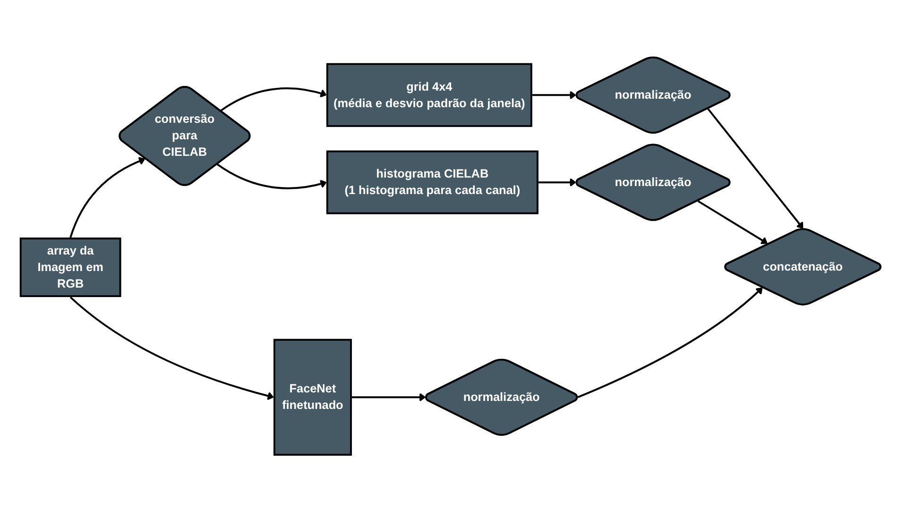
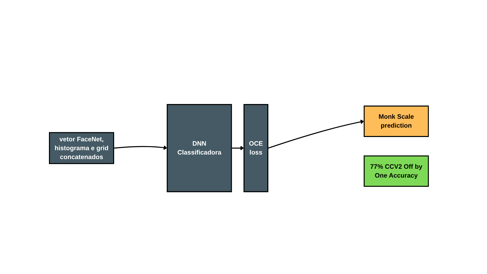

# MSTscale-predictor-2.0
SOTA Monk Skin Tone scale prediction

## Escala Monk Skin Tone

Foi desenvolvida pelo Dr. Ellis P. Monk Jr, pesquisador da Harvard University.
Ela é, atualmente, a escala de classificação de tons de pele reconhecidamente
mais inclusiva e adequada para treinamento de modelos ML.

É uma escala contínua de 10 cores, desenhada especificamente para representar
variações de tom de pele sobre populações diversas.

<a href="https://skintone.google/the-scale">Monk Skin Tone Scale website</a>

## Arquitetura atual

### Inspiração
A arquitetura proposta por este trabalho é inspirada, principalmente, em 3 artigos distintos, porém complementares:

- Artigo 1 (2021): <a href="https://ieeexplore.ieee.org/stamp/stamp.jsp?arnumber=9478885">MAAD-Face: A Massively Annotated Attribute Dataset for Face Images</a>
- Artigo 2 (2024) : <a href="https://repositorio.usp.br/directbitstream/7d2769ea-ed7a-4905-96cd-31b85a51efec/3236270.pdf">Enhancing Fairness in Machine Learning: Skin Tone Classification Using the
Monk Skin Tone Scale</a>
- Artigo 3 (2026) : <a href="https://arxiv.org/pdf/2603.02475">Large-Scale Dataset and Benchmark for Skin Tone Classification in the Wild</a>

Dos artigos 2 e 3, carregamos:
- A proposta de separação de indivíduos por subset de treinamento e teste
- O dataset STW, Skin Tone in the Wild, com anotações de tom de pele quanto à escala Monk Skin Tone

Do artigo 1, carregamos:
- A arquitetura base de classificação de atributos faciais, composta por um vetorizador FaceNet e uma dnn chamada de Mac, Massive Attribute Classifier

### Definição da arquitetura
O pipeline proposto culminou em resultados robustos que o determinaram o atual **estado da arte em classificação de tom de pele em imagens faciais usando a escala Monk Skin Tone**:

 
